<div align="center">


# LapisLLM

**Every spare GPU in the house. One endpoint.**

LapisLLM pools the old gaming PC, the work laptop and the Apple Silicon Mac you already
own into one self-hosted model-serving fleet, behind a single OpenAI-compatible `/v1`
endpoint.

[](https://github.com/Rakshitha-Ireddi/lapis-llm/actions/workflows/ci.yml)
[](https://github.com/Rakshitha-Ireddi/lapis-llm/actions/workflows/pages.yml)
[](https://github.com/Rakshitha-Ireddi/lapis-llm/actions/workflows/codeql.yml)


[](LICENSE)

[**Live site**](https://rakshitha-ireddi.github.io/lapis-llm/) ·
[**Console demo**](https://rakshitha-ireddi.github.io/lapis-llm/console.html) ·
[Architecture](docs/architecture.md) ·
[API](docs/api.md) ·
[Decisions](docs/adr/README.md)

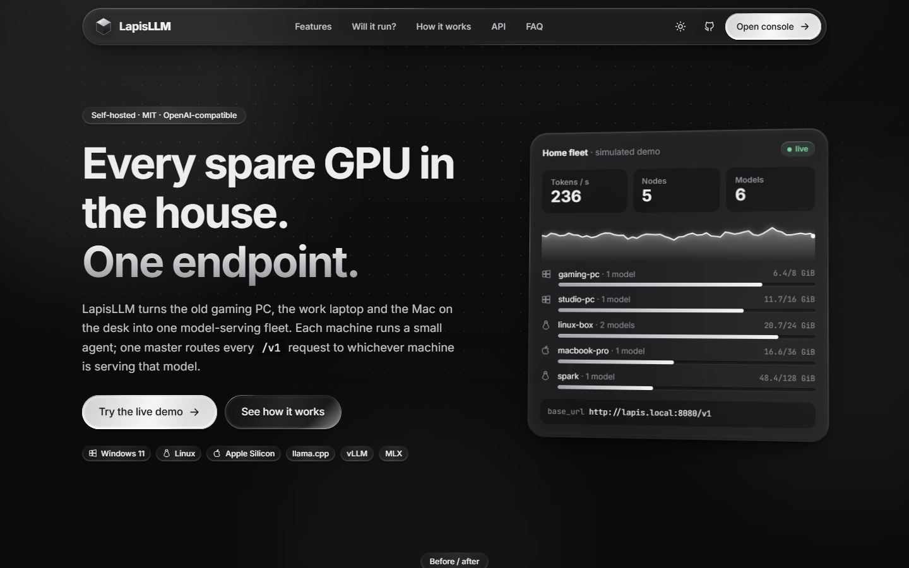

</div>

---

## Table of contents

- [Why](#why)
- [Tested on real hardware](#tested-on-real-hardware)
- [Screenshots](#screenshots)
- [Features](#features)
- [What runs where](#what-runs-where)
- [Quick start](#quick-start)
- [Adding real machines](#adding-real-machines)
- [Calling your models](#calling-your-models)
- [Configuration](#configuration)
- [Architecture](#architecture)
- [Project structure](#project-structure)
- [Development](#development)
- [Testing](#testing)
- [CI/CD and GitHub Pages](#cicd-and-github-pages)
- [Architecture decisions](#architecture-decisions)
- [Roadmap](#roadmap)
- [Contributing, security, license](#contributing-security-license)

## Why

Without a control plane, every machine becomes its own project: its own runtime, its own
flags, its own port, and every client has to remember which model lives where.

LapisLLM is a small control plane for a handful of machines you own:

- A **master** keeps the registry, checks memory, chooses where models run, and routes
  every `/v1` request to the right machine.
- An **agent** on each machine runs llama.cpp, vLLM or MLX, reports GPU / unified-memory
  telemetry, and refuses anything that won't fit.
- Clients use **one base URL and one API key** and pick models by name.

It is not Kubernetes, not a scheduler, and not a hosted service.

## Tested on real hardware

LapisLLM has been run end to end with **real runtimes**, not only the simulator:

| Setup | Result |
|-------|--------|
| **Shared lab server, 8× RTX 3090** (Ubuntu 22.04, CUDA 12.2, llama.cpp built from source), Qwen2.5-7B-Instruct Q4_K_M | Started in **3.6 s** · **90 tok/s** generation · **1,097 tok/s** prompt processing · **33 ms** to first streamed token |
| Same server, live admission | GPU 0 was 100% busy with another user's job → model placed on GPU 1 and **pinned there** (`CUDA_VISIBLE_DEVICES`); a 72B request was refused: *"needs 41.10 GiB but the roomiest GPU has 18.93 GiB free after the 1.00 GiB reserve"* |
| **Windows 11 laptop, CPU only** (llama.cpp b12230), Qwen2.5-0.5B | Fingerprint approval, start in 5.4 s, chat, streaming and embeddings (896-dim) all through `/v1` |

<table>
  <tr>
    <td width="50%">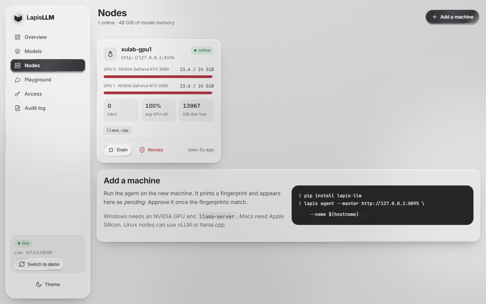<br/><sub>The real lab node: both RTX 3090s filled by other people's jobs (live <code>nvidia-smi</code>), measured disk</sub></td>
    <td width="50%">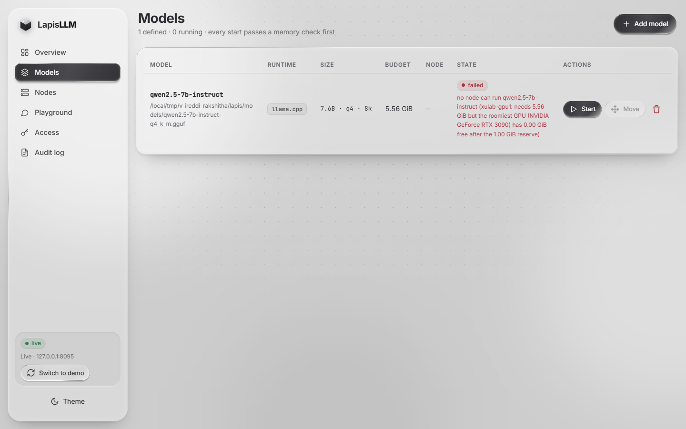<br/><sub>So admission refuses the 7B model, with the numbers, instead of OOM-ing someone's training run</sub></td>
  </tr>
</table>

Testing on real runtimes found and fixed bugs the simulator could not:
upstream HTTP errors were relayed as 200, embedding models needed `--embeddings`,
a keep-alive race dropped heartbeats, and, most importantly, runtimes were **not pinned to
the GPU admission chose**, which on a shared server could spill layers onto other people's cards.

## Screenshots

> Every screenshot is generated by Playwright from the real UI (`npm run screenshots`)
> running the simulated demo fleet.

<table>
  <tr>
    <td width="50%">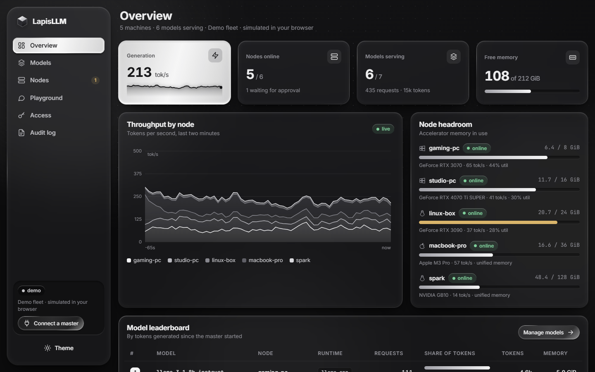<br/><sub><b>Overview</b>: throughput by node, headroom, leaderboard</sub></td>
    <td width="50%">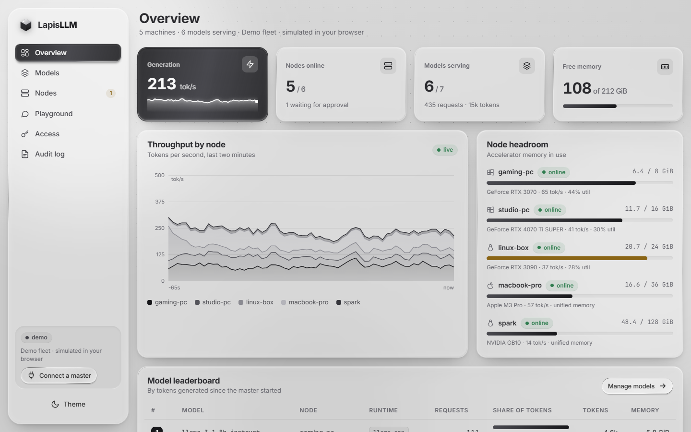<br/><sub><b>Overview</b> in the light theme</sub></td>
  </tr>
  <tr>
    <td>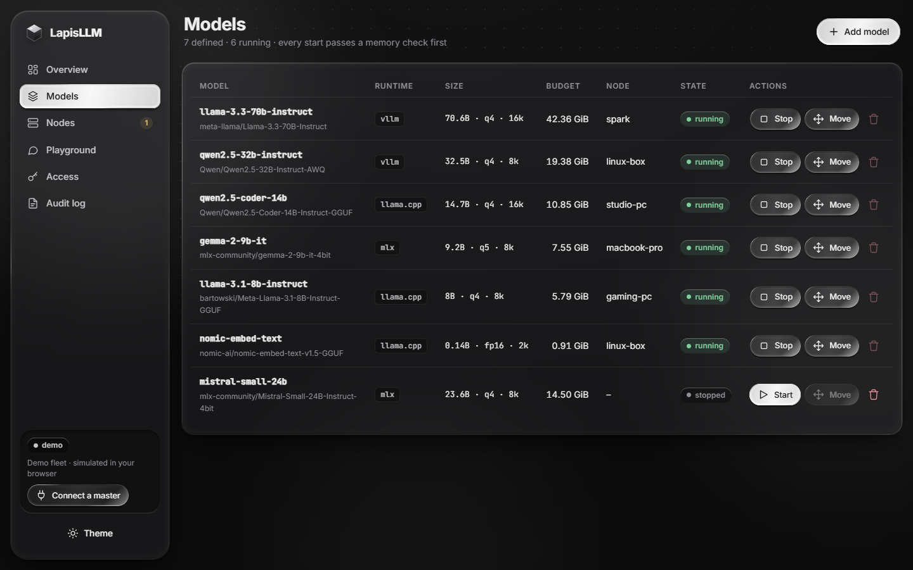<br/><sub><b>Models</b>: start, stop, move, with budgets and placement</sub></td>
    <td>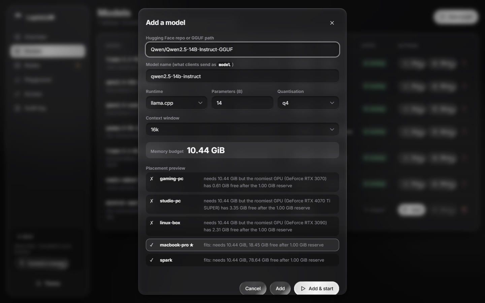<br/><sub><b>Add model</b>: live memory budget and per-node admission</sub></td>
  </tr>
  <tr>
    <td>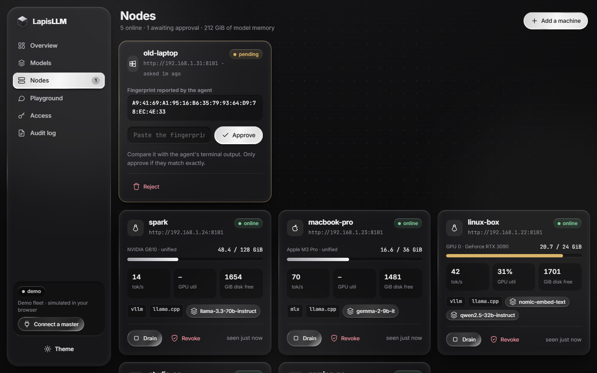<br/><sub><b>Nodes</b>: fingerprint approval, per-GPU memory, drain/revoke</sub></td>
    <td>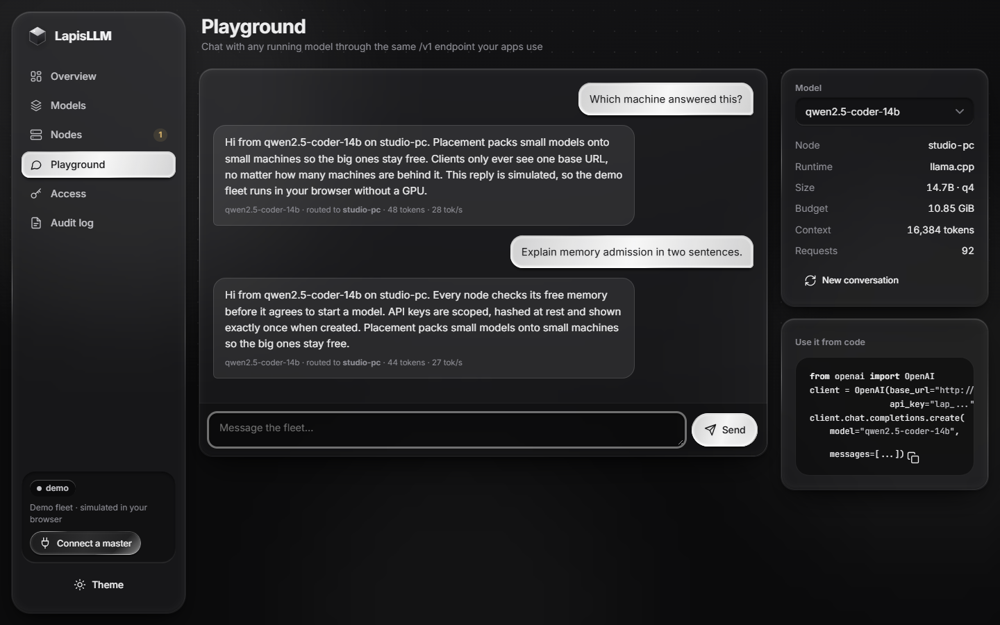<br/><sub><b>Playground</b>: streamed replies, showing which machine answered</sub></td>
  </tr>
  <tr>
    <td>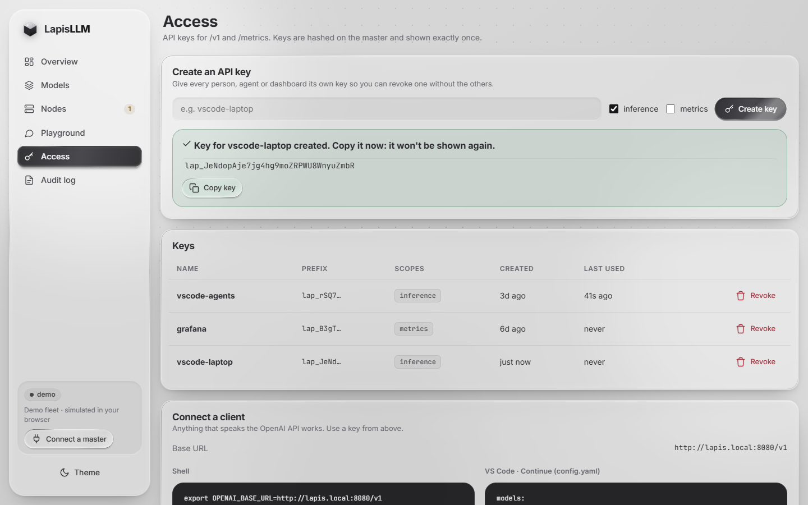<br/><sub><b>Access</b>: scoped API keys shown once, client snippets</sub></td>
    <td>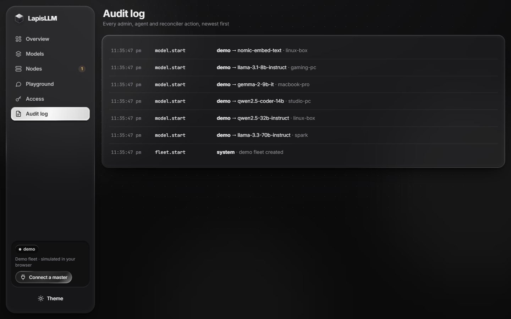<br/><sub><b>Audit log</b>: every admin, agent and reconciler action</sub></td>
  </tr>
  <tr>
    <td>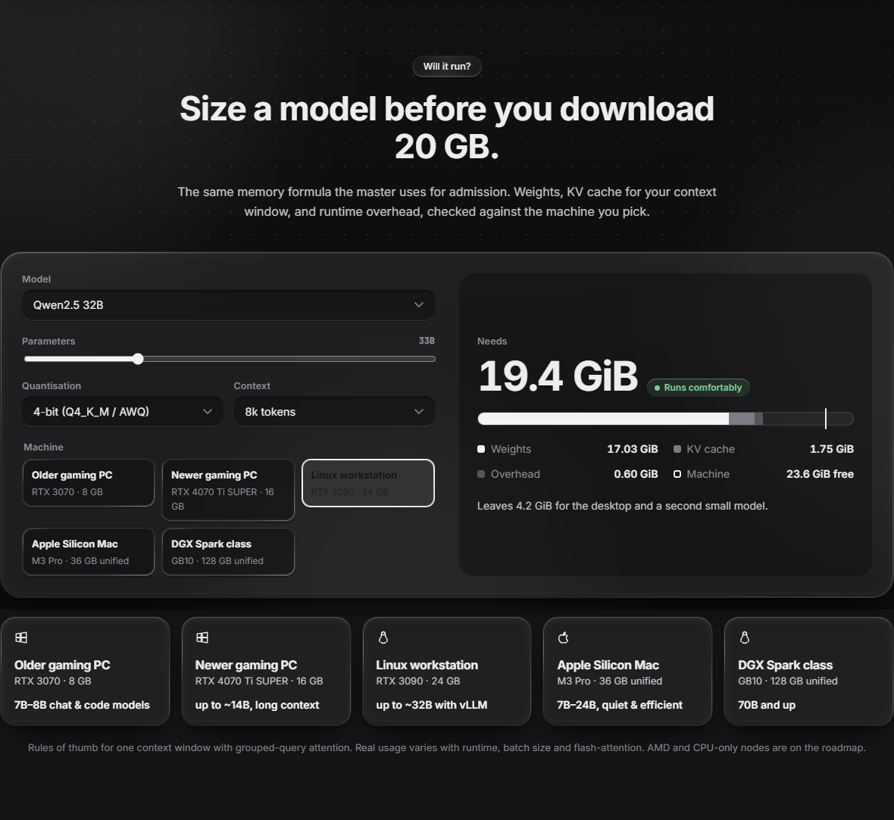<br/><sub><b>Will it run?</b>: the admission formula, in the browser</sub></td>
    <td>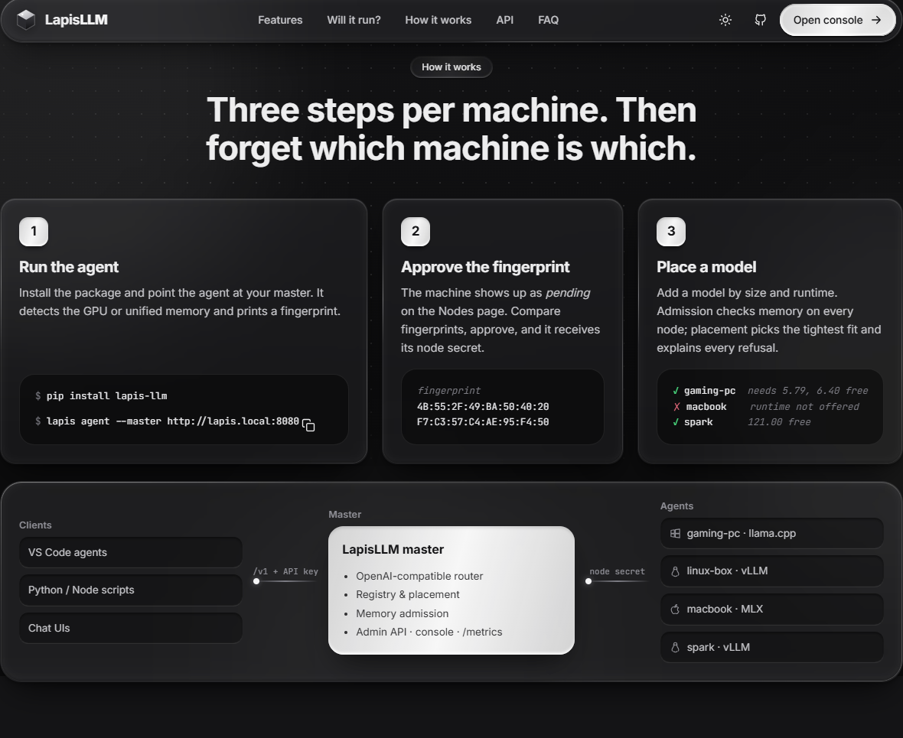<br/><sub><b>How it works</b>: three steps per machine</sub></td>
  </tr>
  <tr>
    <td>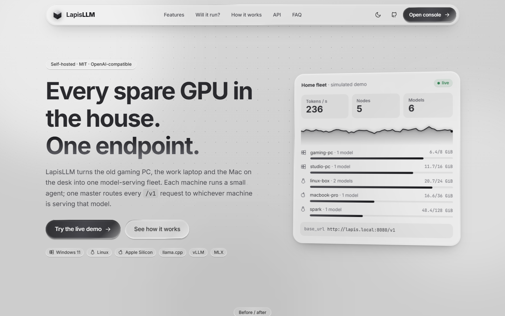<br/><sub>Landing page, light theme</sub></td>
    <td>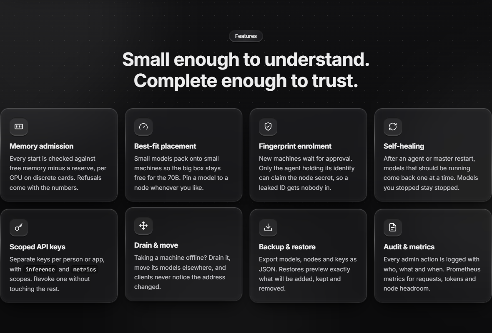<br/><sub>Features</sub></td>
  </tr>
</table>

<p align="center">
  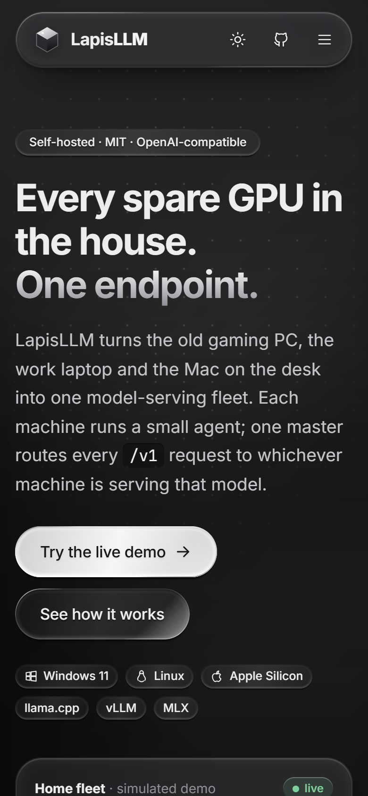
  &nbsp;&nbsp;
  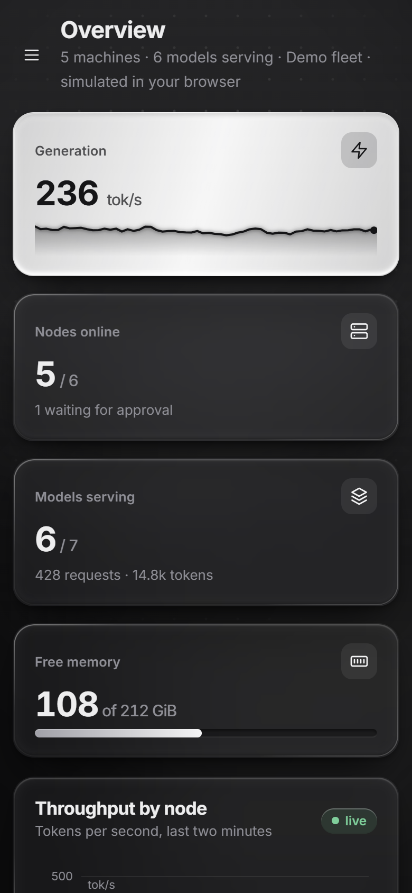
</p>

## Features

| | |
|---|---|
| **One OpenAI-compatible endpoint** | `/v1/models`, chat completions, completions and embeddings, streaming included. `X-Lapis-Node` tells you which machine answered. |
| **Memory admission** | Every start is checked against free memory minus a reserve, **per GPU** on discrete cards, first by the master and again by the agent. Refusals carry the numbers. |
| **Best-fit placement** | Small models pack onto small machines so the big box stays free. Preview the decision before you make it; pin or move whenever you like. |
| **Fingerprint enrolment** | New machines wait as *pending* until an admin types the fingerprint printed on that machine. Only the agent holding its identity can claim the node secret. |
| **Self-healing** | After an agent or master restart, models that should run come back one at a time per node. Models you stopped stay stopped. |
| **Scoped API keys** | `inference` and `metrics` scopes, SHA-256 at rest, shown exactly once. |
| **Drain, move, revoke** | Take a machine out of rotation without clients noticing. |
| **Backup & restore** | JSON export without secrets; restores preview *add / keep / remove* first. |
| **Observability** | Prometheus `/metrics`, an audit log, and a live console. |
| **Runs anywhere** | Windows 11 + NVIDIA (llama.cpp), Linux + NVIDIA (vLLM, llama.cpp), Apple Silicon (MLX, llama.cpp). |
| **Try without a GPU** | `lapis demo` runs a real master and five simulated nodes; the website runs the same simulation in your browser. |
| **Liquid-glass UI** | Monochrome: frosted glass that catches light and tips when pressed. Light and dark themes, keyboard accessible, reduced-motion aware, responsive down to phones. |

## What runs where

Rule of thumb for 4-bit models with an 8k context ([formula](docs/adr/0009-shared-sizing-fixture.md)):

| Machine | Memory | Comfortable model size | Typical runtime |
|---------|--------|------------------------|-----------------|
| Older gaming PC (RTX 3070) | 8 GB | 7B–8B | llama.cpp on Windows |
| Newer gaming PC (RTX 4070 Ti SUPER) | 16 GB | up to ~14B | llama.cpp |
| Linux workstation (RTX 3090) | 24 GB | up to ~32B | vLLM / llama.cpp |
| Apple Silicon Mac | 32–36 GB unified | 7B–24B | MLX / llama.cpp |
| DGX Spark class (GB10) | 128 GB unified | 70B and up | vLLM |

```bash
$ lapis estimate --params 32 --quant q4 --memory 24
32.0B @ q4, 8192 tokens of context -> 19.10 GiB
On 24 GiB: comfortable
Best comfortable quantisation: q4
```

## Quick start

### Option A: the demo fleet (no GPU, two minutes)

```bash
git clone https://github.com/Rakshitha-Ireddi/lapis-llm
cd lapis-llm

# build the console once
cd web && npm ci && npm run build && cd ..

# run a master + five simulated machines
cd server
python -m venv .venv && source .venv/bin/activate   # Windows: .venv\Scripts\activate
pip install -e .
lapis demo --web-dir ../web/dist
```

Open **http://localhost:8080/console.html** and log in with `lapis-demo`.

### Option B: Docker

```bash
docker compose -f deploy/docker-compose.yml --profile demo up --build
```

### Option C: just look

The [hosted console](https://rakshitha-ireddi.github.io/lapis-llm/console.html) runs the
same demo fleet entirely in your browser.

## Adding real machines

**1. Start the master** on any always-on box:

```bash
cp deploy/.env.example deploy/.env     # set LAPIS_ADMIN_PASSWORD
docker compose -f deploy/docker-compose.yml --profile master up -d --build
# or: LAPIS_ADMIN_PASSWORD=… lapis master --web-dir web/dist
```

**2. Run an agent** on each machine with a GPU (the runtime must be installed there:
`llama-server`, `vllm` or `mlx_lm.server`):

```bash
pip install lapis-llm
lapis agent --master http://<master-ip>:8080 --name gaming-pc \
            --advertise-url http://<this-machine-ip>:8101
```

It prints a fingerprint such as `4B:55:2F:49:BA:50:40:20:F7:C3:57:C4:AE:95:F4:50`.

**3. Approve it** on the console's **Nodes** page by pasting that fingerprint.

**4. Add a model** on the **Models** page. The dialog shows the memory budget and
which machine it will land on before you click *Add & start*.

Want to try the agent without a GPU? `lapis agent --master … --preset gaming-pc`.

Runtime-specific flags go in the model's `args`, e.g. `["--pooling", "mean"]` or
`["--flash-attn", "on"]`; model names containing `embed` get `--embeddings` automatically.

## Calling your models

Create a key on the **Access** page, then use any OpenAI client:

```python
from openai import OpenAI

client = OpenAI(base_url="http://lapis.local:8080/v1", api_key="lap_...")
stream = client.chat.completions.create(
    model="qwen2.5-coder-14b",
    messages=[{"role": "user", "content": "Write a haiku about GPUs"}],
    stream=True,
)
for chunk in stream:
    print(chunk.choices[0].delta.content or "", end="")
```

```bash
curl http://lapis.local:8080/v1/models -H "Authorization: Bearer $LAPIS_KEY"
```

<details>
<summary>VS Code (Continue) config</summary>

```yaml
models:
  - name: Lapis coder
    provider: openai
    model: qwen2.5-coder-14b
    apiBase: http://lapis.local:8080/v1
    apiKey: lap_...
```

</details>

## Configuration

Environment variables for the master (see [`deploy/.env.example`](deploy/.env.example)):

| Variable | Default | Purpose |
|----------|---------|---------|
| `LAPIS_ADMIN_PASSWORD` | *generated and logged* | Console / admin API password |
| `LAPIS_REQUIRE_API_KEY` | `true` | Require a key for `/v1` and `/metrics` |
| `LAPIS_MEMORY_RESERVE_GIB` | `1.0` | Memory kept free on every node / GPU |
| `LAPIS_HEARTBEAT_TIMEOUT_S` | `30` | Silence before a node shows as offline |
| `LAPIS_DATA_DIR` | `./data` | Where `state.json` and `audit.jsonl` live |
| `LAPIS_WEB_DIR` | *unset* | Serve the built console from this folder |
| `LAPIS_SESSION_SECRET` | *random per start* | Pin to keep admin logins across restarts |
| `LAPIS_CORS_ORIGINS` | *unset* | Comma-separated origins, e.g. your Pages URL |
| `LAPIS_AUTO_APPROVE` | `false` | Demo only: approve every enrolment |

Agent flags: `--master`, `--name`, `--port` (8101), `--advertise-url`, `--preset`,
`--runtime` (repeatable), `--gpus` (e.g. `1` or `0,2`, for shared machines), `--reserve`,
`--state-dir`. On real hardware the agent re-reads `nvidia-smi` on every heartbeat, so
admission sees memory used by *other* processes too. Runtime binaries can be overridden
with `LAPIS_LLAMA_SERVER`, `LAPIS_VLLM`, `LAPIS_MLX_SERVER`.

## Architecture

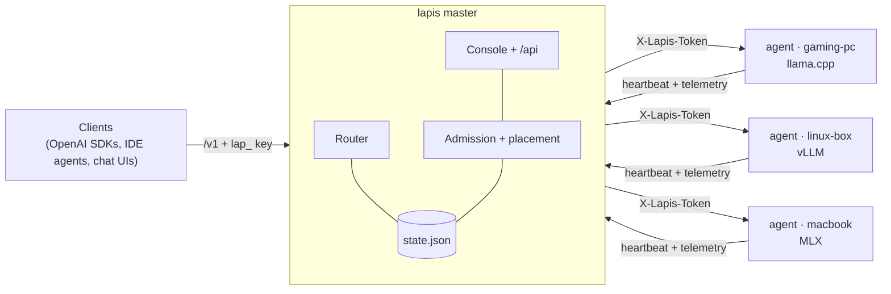

Request flow, enrolment sequence and model state machine:
**[docs/architecture.md](docs/architecture.md)**. Endpoints: **[docs/api.md](docs/api.md)**
(or `/docs` on a running master).

## Project structure

```
lapis-llm/
├── server/                     Python package `lapis-llm` (master + agent + CLI)
│   ├── src/lapis/
│   │   ├── master/             app.py (HTTP), fleet.py (state), agent_client.py
│   │   ├── agent/              app.py, node.py, runtimes.py, hardware.py
│   │   ├── sizing.py           memory estimate      ┐ mirrored in web/src/lib
│   │   ├── admission.py        will it fit, and why ┘ and tested via shared/
│   │   ├── placement.py        best fit
│   │   ├── domain.py           Pydantic wire types
│   │   ├── security.py, store.py, audit.py, metrics.py, config.py
│   │   └── cli.py              lapis master | agent | demo | estimate
│   └── tests/                  pytest (in-process master + agents)
├── web/                        Vite + TypeScript, no framework
│   ├── index.html              landing page
│   ├── console.html            operator console
│   ├── src/
│   │   ├── lib/                sizing, admission, demo-fleet, types, format
│   │   ├── console/            api.ts (Live/Demo), main.ts, views/*
│   │   ├── ui/                 icons, chart, theme, dom helpers
│   │   └── styles/             glass.css (design system), landing.css, console.css
│   ├── tests/                  Vitest
│   └── e2e/                    Playwright (+ screenshot generator)
├── shared/sizing-cases.json    cross-language test fixture
├── deploy/                     Dockerfile, docker-compose.yml, .env.example
├── docs/                       architecture, API, ADRs, screenshots
├── scripts/                    fixture generator
└── .github/                    CI, Pages, release, CodeQL, Dependabot, templates
```

## Development

```bash
# terminal 1: backend with live data
cd server && pip install -e ".[dev]" && lapis demo

# terminal 2: frontend with hot reload (proxies /api and /v1 to :8080)
cd web && npm ci && npm run dev
```

Open http://localhost:5173/console.html. It detects the master and switches to live mode.
Append `?demo` to force the in-browser simulation, or `?theme=light|dark`.

## Testing

| Suite | Command | What it covers |
|-------|---------|----------------|
| Server | `cd server && pytest --cov` | 103 tests, ~84% coverage: sizing, admission, placement, enrolment, recovery, routing, streaming, keys, backup, CLI |
| Lint | `ruff check . && ruff format --check .` | Python style and bugs |
| Web unit | `cd web && npm test` | 58 tests: sizing (shared fixture), admission, demo fleet, formatting, SSE parsing |
| Types | `npm run typecheck` | strict TypeScript |
| End-to-end | `npx playwright test` | 16 browser tests: landing, calculator, console flows, mobile layout |
| Screenshots | `npm run build && npm run screenshots` | regenerates `docs/screenshots/` |

Use an installed browser instead of downloading one: `PW_CHANNEL=msedge` or `PW_CHANNEL=chrome`.

## CI/CD and GitHub Pages

| Workflow | Runs on | Does |
|----------|---------|------|
| [`ci.yml`](.github/workflows/ci.yml) | push to `main`, PRs | ruff + pytest (3.11, 3.12) · typecheck + Vitest + build · Playwright · Docker build |
| [`pages.yml`](.github/workflows/pages.yml) | push to `main` touching `web/` | builds the site and deploys it to GitHub Pages |
| [`release.yml`](.github/workflows/release.yml) | tag `v*.*.*` | multi-arch image → `ghcr.io/rakshitha-ireddi/lapis-llm`, wheel → GitHub Release |
| [`codeql.yml`](.github/workflows/codeql.yml) | push, PRs, weekly | code scanning for Python and TypeScript |

**Deploy the site to GitHub Pages:**

1. Push the repository to GitHub.
2. **Settings → Pages → Build and deployment → Source: GitHub Actions.**
3. Push to `main` (or run *Deploy site to GitHub Pages* manually from the Actions tab).
4. The site appears at `https://<Rakshitha-Ireddi>.github.io/<repo>/`. Asset paths are
   relative, so no base-path configuration is needed, and a custom domain works too.

Before publishing, replace `Rakshitha-Ireddi` in `web/src/config.ts`, this README and
`CHANGELOG.md` with your GitHub username.

## Architecture decisions

The "why" behind the design lives in [`docs/adr`](docs/adr/README.md):

0001 Record decisions · 0002 Python + FastAPI · 0003 One OpenAI-compatible endpoint ·
0004 Memory admission, checked twice · 0005 Best-fit placement · 0006 Fingerprint
enrolment · 0007 JSON state store · 0008 Simulated runtime · 0009 Shared sizing fixture ·
0010 Static console on Pages · 0011 Blue glassmorphism (superseded) · 0012 CI and releases ·
0013 Monochrome liquid glass

## Roadmap

- [ ] mTLS between master and agents (supersedes ADR 0006)
- [ ] Hugging Face downloads with GGUF header inspection
- [ ] Benchmarks and a runtime-settings tuner
- [ ] Replicas: the same model on several nodes with load balancing
- [ ] Tensor-parallel placement across GPUs
- [ ] AMD (ROCm) and CPU-only nodes
- [ ] Scheduled backups to SMB/NFS
- [ ] MCP endpoint

## Contributing, security, license

- Contributions are welcome. Start with [CONTRIBUTING.md](CONTRIBUTING.md).
- Please report vulnerabilities privately. See [SECURITY.md](SECURITY.md).
- [MIT](LICENSE) licensed.
