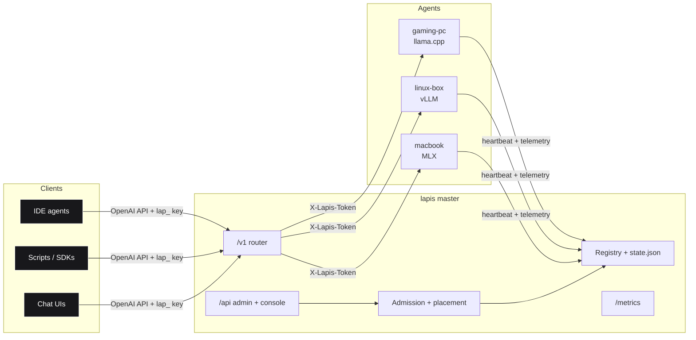
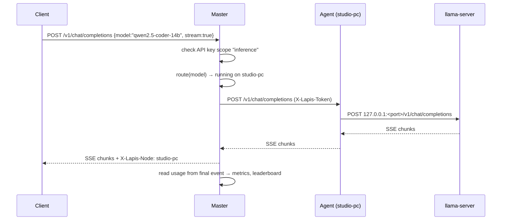
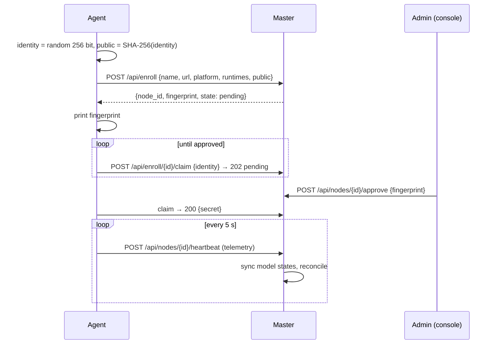
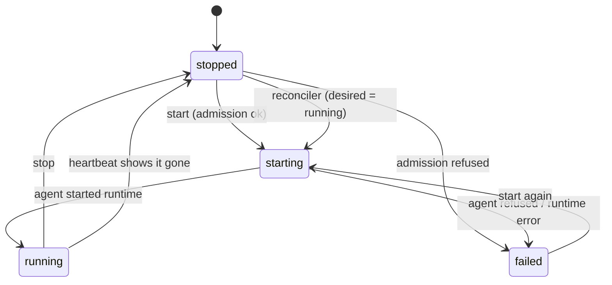

# Architecture

LapisLLM has two processes and one browser app.

## Components

| Module | Responsibility |
|--------|----------------|
| `lapis.sizing` | Memory estimate from params / quant / context ([ADR 0009](adr/0009-shared-sizing-fixture.md)) |
| `lapis.admission` | Will this budget fit on this node, and if not, why ([ADR 0004](adr/0004-memory-admission-before-start.md)) |
| `lapis.placement` | Evaluate every node, pick best fit ([ADR 0005](adr/0005-best-fit-placement.md)) |
| `lapis.master.fleet` | Source of truth: nodes, models, keys, reconcile, backup/restore |
| `lapis.master.agent_client` | Master → agent HTTP (start, stop, proxy, stream) |
| `lapis.master.app` | FastAPI app: `/api`, `/v1`, `/metrics`, `/healthz`, static console |
| `lapis.agent.node` | The agent's view of its machine: telemetry, local admission, enrol/claim/heartbeat loop |
| `lapis.agent.runtimes` | `SimulatedRuntime` and `ProcessRuntime` (llama.cpp / vLLM / MLX) |
| `lapis.agent.hardware` | `nvidia-smi` / `sysctl` detection and simulated presets |
| `lapis.security` | Fingerprints, HMAC sessions, API key and secret generation |
| `lapis.store`, `lapis.audit`, `lapis.metrics` | JSON state, JSONL audit, Prometheus text |

## Request flow: a streamed chat completion

## Lifecycle: joining a machine

## Model states

`desired` is separate from `state`. After a node or master restart, the reconciler
restarts only models whose `desired` is `running`, one at a time per node. A model the
operator stopped stays stopped.

## What the master never does

- Touch a GPU or a model file. Agents own their machine.
- Store plaintext API keys. Only SHA-256 hashes are persisted.
- Return node secrets or public keys through the admin API.

## Tests

| Layer | Tool | Where |
|-------|------|-------|
| Python units + integration | pytest, in-process ASGI transports (master + N agents, no sockets) | `server/tests` |
| TypeScript units | Vitest | `web/tests` |
| Cross-language contract | shared fixture | `shared/sizing-cases.json` |
| Browser e2e | Playwright (desktop + Pixel 7) | `web/e2e` |
| Screenshots | Playwright | `web/e2e/screenshots.spec.ts` → `docs/screenshots` |
